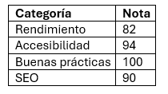
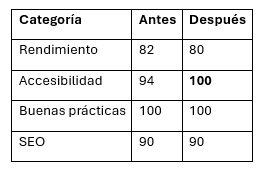

## Resumen del “antes” (móvil, Slow 4G)

## Reporte “después” (móvil, Slow 4G) - Comparativa

### Mejoras aplicadas
1. **Contraste (accesibilidad):** se reemplazó `text-gray-400` por `text-gray-600` en fechas de reseñas y categorías de las tarjetas. Lighthouse marcaba contraste insuficiente.
2. **Enlaces idénticos (accesibilidad):** los enlaces "Ver detalle" de las tarjetas ahora tienen un `aria-label` con el nombre del proveedor. Desapareció el aviso "Identical links have the same purpose".

### Pendiente
- **Rendimiento:** script de Tailwind por CDN (*render-blocking*, ~1,1 s estimado) y la latencia de la API en un plan gratuito. Mejora: compilar Tailwind con la CLI.
- **SEO:** agregar meta description.

## Capturas

### Antes

### Después

